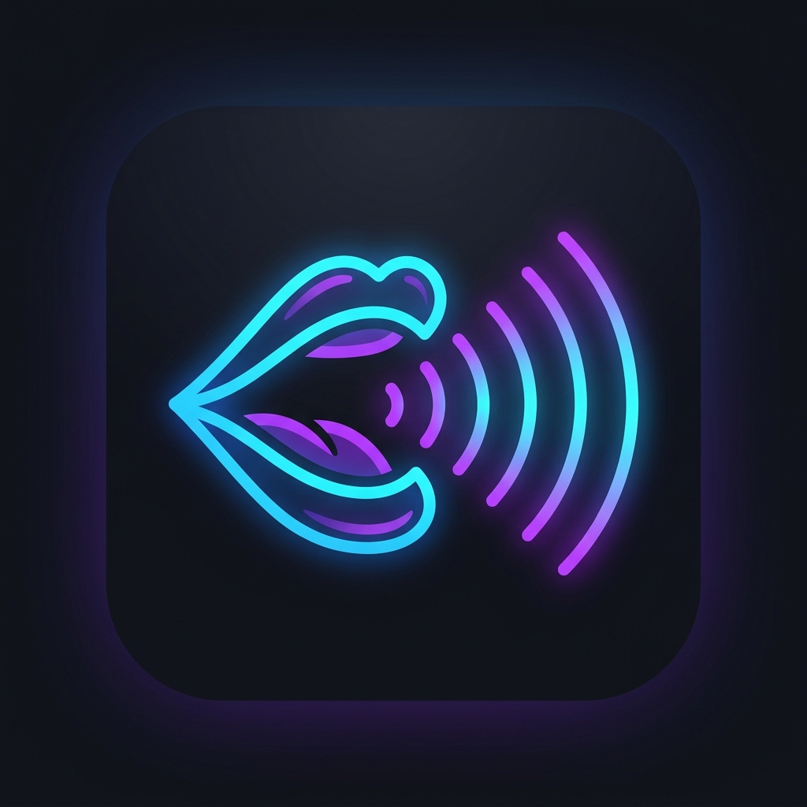
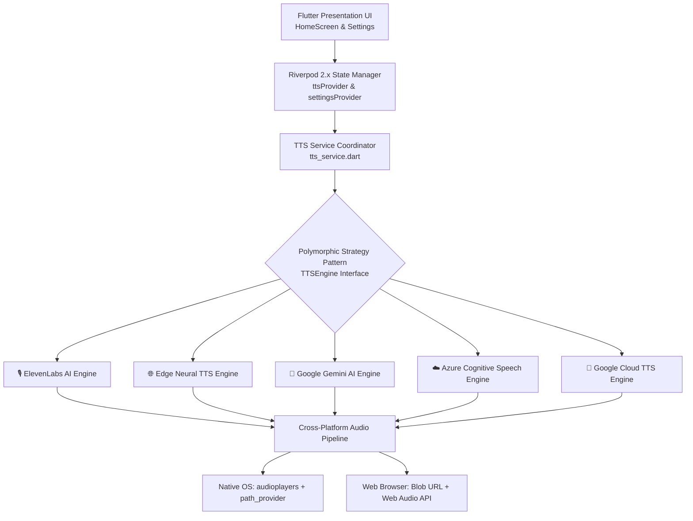

<p align="center">
  
</p>

# 🎙️ Multi-Engine Neural Text-to-Speech (TTS) Studio

<p align="left">
  
  
  
  
  
  
</p>

A cross-platform **Neural Text-to-Speech (TTS) application** built with Flutter and Dart, engineered with a pluggable, polymorphic multi-engine architecture. Inspired by high-fidelity audio platforms like ElevenLabs, it allows users to synthesize, stream, and export human-like speech across multiple AI voice backends.

---

## 🏗️ System Architecture & Design Patterns

The application is structured around the **Strategy Pattern**, abstracting voice synthesis behind a unified `TTSEngine` interface. This allows seamless switching between local, cloud, and generative AI voice providers at runtime without modifying UI state.



---

## ✨ Core Features

* **Multi-Engine Voice Synthesis:**
  * **ElevenLabs Integration:** High-fidelity, emotional AI speech cloning and generation via REST API.
  * **Edge Neural TTS:** Ultra-fast, zero-cost neural speech with dozens of international accents and voice models.
  * **Google Gemini AI Engine:** Integrates Google's generative AI models for speech synthesis.
  * **Microsoft Azure & Google Cloud TTS:** Enterprise-tier speech synthesis with fine-grained SSML pitch, rate, and timbre adjustments.
* **Reactive State Architecture:** Built with **Riverpod 2.x** ensuring strict separation of UI components from network requests and audio playback streams.
* **Cross-Platform Audio Pipelines:**
  * Uses conditional Dart compilation (`downloader_stub.dart` vs `downloader_web.dart`) to handle audio playback and MP3 file downloads natively across Android, Windows, and Web.
* **Audio Export & Sharing:** Export synthesized audio directly to high-bitrate `.mp3` files or share via native system sheets (`share_plus`).
* **Modern Material 3 UI:** Clean, dark/light responsive interface with customized typography via Google Fonts and reactive toast feedback.

---

## 📂 Project Organization

```text
lib/
├── models/                  # Data transfer objects (Voice, Language, EngineConfig)
├── providers/               # Riverpod state notifiers (tts_provider, settings_provider)
├── screens/                 # UI screens (home_screen, settings_dialog)
├── services/
│   ├── engines/             # Pluggable TTS backends (Strategy Pattern)
│   │   ├── tts_engine.dart          # Base polymorphic interface
│   │   ├── elevenlabs_engine.dart   # ElevenLabs REST API integration
│   │   ├── gemini_engine.dart       # Google Gemini AI speech pipeline
│   │   ├── azure_engine.dart        # Microsoft Azure Cognitive Speech
│   │   ├── edge_engine.dart         # Edge Neural voice wrapper
│   │   └── google_cloud_engine.dart # Google Cloud Text-to-Speech
│   └── tts_service.dart             # Core coordinator service
└── utils/                   # Platform-conditional audio helpers and downloaders
```

---

## 🚀 Getting Started

### Prerequisites
* **Flutter SDK:** `>=3.0.0 <4.0.0`
* **Dart SDK:** `>=3.0.0`
* **Android Studio / VS Code** with Flutter extensions enabled

### Installation & Run

1. **Clone the repository:**
   ```bash
   git clone https://github.com/solokool66/flutter-text-to-speech.git
   cd flutter-text-to-speech
   ```

2. **Install Flutter packages:**
   ```bash
   flutter pub get
   ```

3. **Run on your connected device or emulator:**
   ```bash
   # Run on Chrome (Web)
   flutter run -d chrome

   # Run on Android
   flutter run -d android

   # Run on Windows Desktop
   flutter run -d windows
   ```

---

## 👨‍💻 Author & Engineering Profile

**Solomon, Kingsley Eze**  
*Full-Stack Software & Network Systems Engineer*  
* **GitHub:** [@solokool66](https://github.com/solokool66)  
* **LinkedIn:** [linkedin.com/in/solokool](https://www.linkedin.com/in/solokool/)  
* **Email:** [solokool66@gmail.com](mailto:solokool66@gmail.com)  
* *Available for immediate international relocation (Canada LMIA / Global Talent Stream / SINP Tech Pathway ready).*
